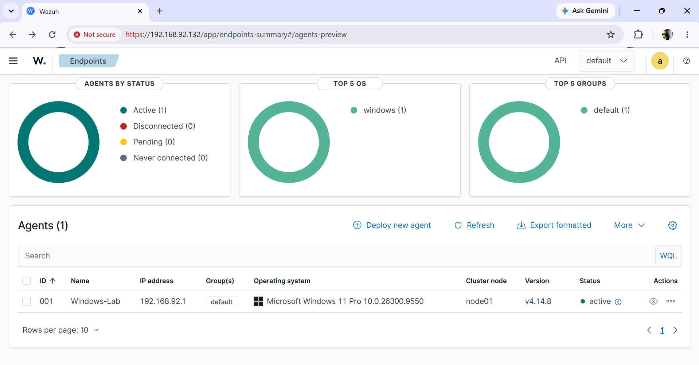
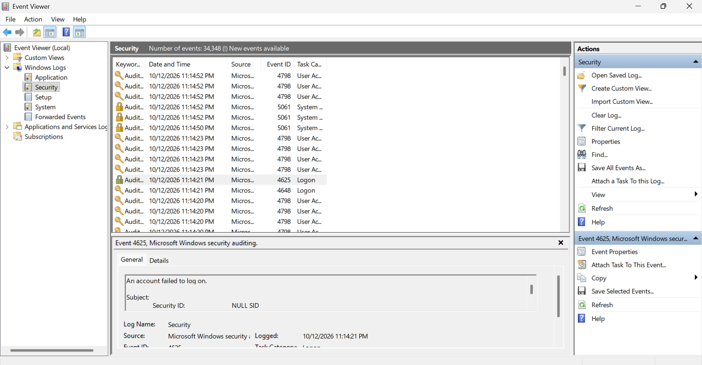
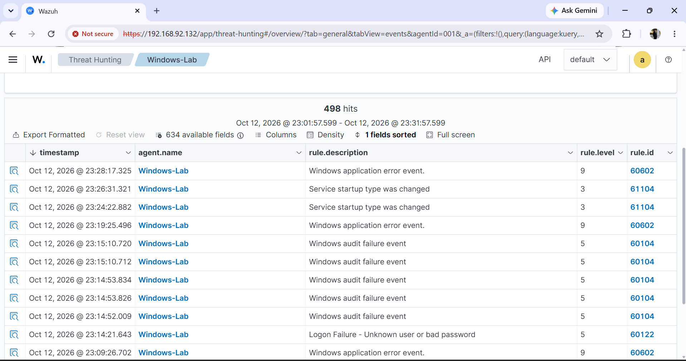
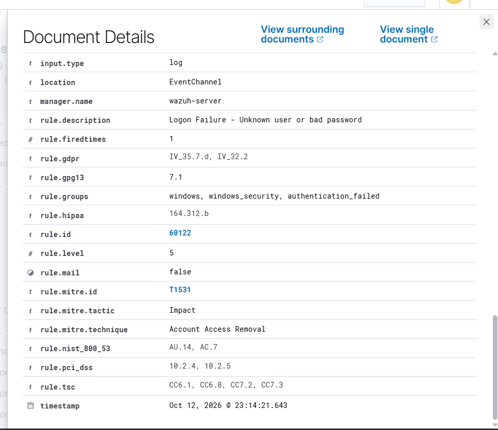
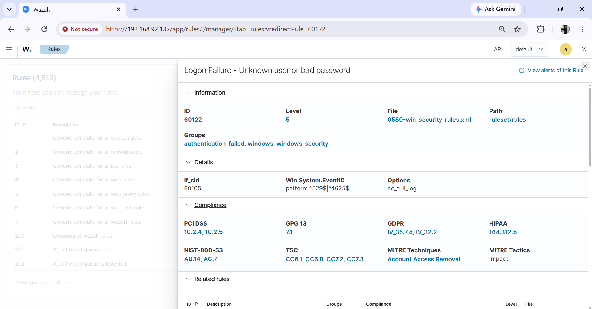
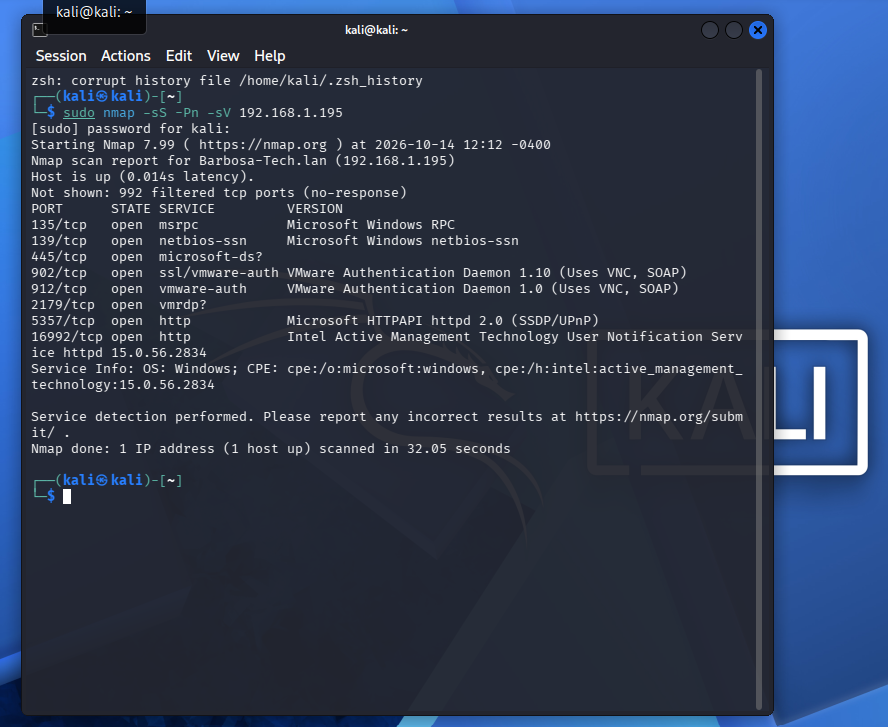
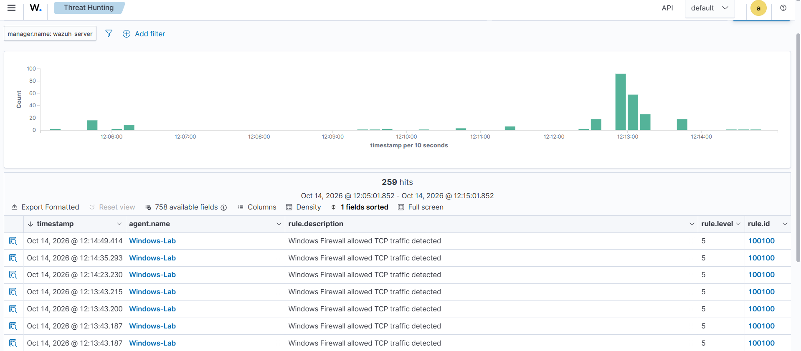
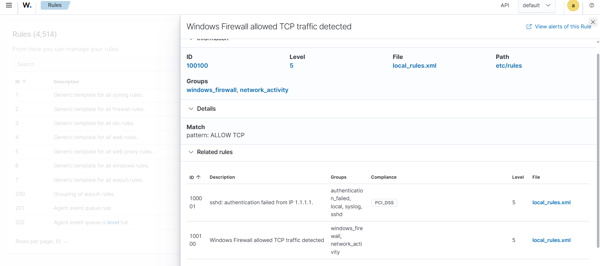
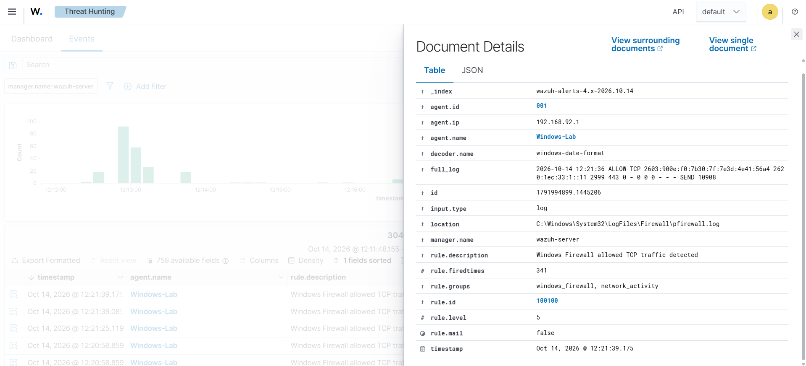

# Wazuh SIEM Home Lab

## Project Overview

This project demonstrates how I built a cybersecurity home lab using Wazuh SIEM to monitor Windows security events, investigate failed login attempts, and detect network activity.

The goal was to gain hands-on experience with security monitoring, log analysis, threat hunting, and custom detection rules, which are important skills for a Security Operations Center (SOC) Analyst.

## Tools and Technologies

- **Wazuh SIEM:** Security monitoring, alerting, and log analysis
- **VMware Workstation:** Virtual machine environment
- **Windows:** Monitored endpoint
- **Kali Linux:** Network scanning and testing
- **Nmap:** Network discovery and service enumeration
- **Windows Event Viewer:** Investigation of Windows security logs
- **Windows Firewall:** Network traffic logging

## Lab Architecture

The lab consisted of three main systems:

- **Wazuh Server:** Hosted the SIEM manager, indexer, and dashboard inside a VMware virtual machine.
- **Windows Endpoint:** Ran the Wazuh agent to forward Windows security events and firewall logs.
- **Kali Linux VM:** Used Nmap to scan the Windows endpoint and generate network activity.

The Wazuh dashboard was accessed through a browser on the Windows endpoint.

## Investigation 1: Failed Login Detection

I investigated failed Windows authentication attempts using Windows Event Viewer and Wazuh.

Windows Event Viewer recorded failed logins under **Event ID 4625**. Wazuh collected these events and generated security alerts.

The investigation included:

1. Reviewing failed login events in Windows Event Viewer.
2. Locating related alerts in Wazuh Threat Hunting.
3. Examining alert severity, timestamps, and rule descriptions.
4. Identifying Wazuh rule **60122**, which detects unknown users or incorrect passwords.

### Evidence

**Windows agent connected**



**Windows failed login event**



**Wazuh threat hunting**



**Wazuh alert details**



**Failed login detection rule**



## Investigation 2: Network Scanning and Firewall Monitoring

I used Kali Linux and Nmap to scan my Windows endpoint in an authorized home lab environment.

The scan command was:

```bash
sudo nmap -sS -Pn -sV 192.168.1.195
```

The scan identified several open TCP ports, including 135, 139, 445, 902, 912, 2179, 5357, and 16992.

I enabled Windows Firewall logging and configured the Wazuh agent to collect the firewall log from:

```text
C:\Windows\System32\LogFiles\Firewall\pfirewall.log
```

I then created a custom Wazuh detection rule to alert when allowed TCP traffic appeared in the collected firewall logs.

### Custom Wazuh Rule

```xml
<group name="windows_firewall,network_activity,">
  <rule id="100100" level="5">
    <match>ALLOW TCP</match>
    <description>Windows Firewall allowed TCP traffic detected</description>
  </rule>
</group>
```

The rule successfully generated Level 5 alerts in Wazuh.

These alerts confirmed that Windows Firewall logs were reaching the SIEM and triggering the custom rule. The rule detects allowed TCP traffic generally; it does not specifically identify Nmap scans.

### Evidence

**Kali Linux Nmap scan**



**Wazuh network activity alerts**



**Custom detection rule**



**Firewall alert details**



## Skills Demonstrated

- SIEM deployment and configuration
- Endpoint security monitoring
- Windows security event analysis
- Log collection and correlation
- Threat hunting and alert investigation
- Network scanning with Nmap
- Windows Firewall log analysis
- Custom Wazuh detection rule creation
- Security investigation documentation

## Key Takeaways

This project helped me understand how security events move from an endpoint into a SIEM and how analysts investigate those events.

I gained practical experience troubleshooting Wazuh services, analyzing Windows authentication failures, configuring firewall log collection, and creating custom detection rules.

The project also demonstrated the importance of verifying alerts against the original log data rather than assuming that every network alert represents an attack.

## Future Improvements

- Develop more specific network scan detection rules.
- Add additional monitored endpoints.
- Create dashboards for authentication failures and network events.
- Explore automated alert notifications and incident response workflows.
